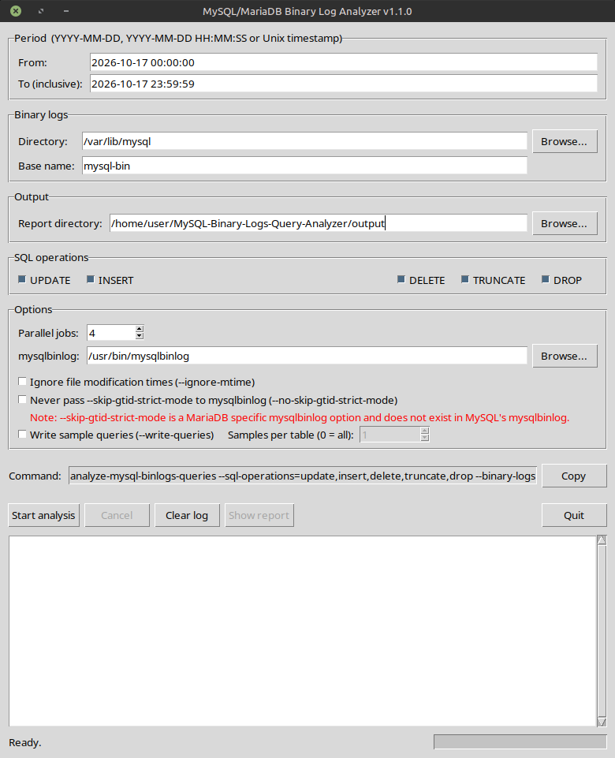

# MySQL/MariaDB Binary Log Analyzer

A command-line Python tool that analyzes MySQL or MariaDB binary logs and reports how many `INSERT`, `UPDATE`, `DELETE`, `TRUNCATE`, and `DROP` operations were recorded for each table during a specified time period.

The tool delegates binary-log decoding to `mysqlbinlog`, streams the decoded output, and counts matching operations per table. It can optionally save sample SQL statements or decoded row images for each operation type.

## Features

- Analyze binary logs for a configurable time window.
- Count operations by table for:
  - `INSERT`
  - `UPDATE`
  - `DELETE`
  - `TRUNCATE`
  - `DROP`
- Handle row-based events (`mysqlbinlog -v`) and recognize supported statement-based SQL and DDL.
- Process multiple binary log files in parallel.
- Select candidate log files by filename and modification time, or disable the modification-time pre-filter.
- Generate a text report and a list of analyzed binary logs.
- Optionally save example queries to separate SQL files by operation type.
- Limit the number of saved query examples per operation and table, or save all matches.
- Write generated files with restrictive `0600` permissions and use a private temporary directory for query-sampling scratch data.
- Use colored terminal output where supported; disable it with `--no-color` or the `NO_COLOR` environment variable.

## Requirements

- Python 3.
- The MySQL or MariaDB `mysqlbinlog` command-line utility, available on `PATH` or supplied with `--mysqlbinlog`.
- Read and search permissions for the binary-log directory.
- Write and search permissions for the output directory.

The tool reads local binary-log files. It does not connect to a MySQL/MariaDB server itself.

## Installation

Save the script as, for example, `analyze-mysql-binlogs-queries`, then make it executable:

```bash
chmod +x analyze-mysql-binlogs-queries
```

Check that Python and `mysqlbinlog` are available:

```bash
python3 --version
mysqlbinlog --version
```

If the executable is not on `PATH`, pass its absolute path with `--mysqlbinlog`.

> **Permissions:** Binary logs can contain sensitive database activity and values. Run the analyzer with an account that can read the logs, and protect the output directory appropriately.

## Quick start

Analyze today's binary logs using the defaults:

```bash
./analyze-mysql-binlogs-queries
```

By default, the script:

- Analyzes the current local day, from `00:00:00` through `23:59:59`.
- Looks for files named `mysql-bin.<number>` in `/var/lib/mysql`.
- Writes results to the current working directory.
- Counts all five supported operation types.
- Uses up to four parallel workers, limited by the available CPU count.
- Does not write sample queries unless `--write-queries` is specified.

To see all command-line options:

```bash
./analyze-mysql-binlogs-queries --help
```

## Command-line options

Options may be supplied in any order. The short and long forms shown below are alternatives for the same option.

| Option                                    | Default | Description                                                                                                   |
|-------------------------------------------|---|---------------------------------------------------------------------------------------------------------------|
| `-h`, `--help`                            | — | Show the command-line help and exit. Provided by Python's `argparse`.                                         |
| `-f DATETIME`, `--dt-from DATETIME`       | Today at `00:00:00` | Inclusive start of the analysis period.                                                                       |
| `-t DATETIME`, `--dt-to DATETIME`         | Today at `23:59:59` | Inclusive end of the analysis period.                                                                         |
| `-n NAME`, `--binary-logs-file-name NAME` | `mysql-bin` | Binary-log base name, without the numeric suffix.                                                             |
| `-p PATH`, `--binary-logs-file-path PATH` | `/var/lib/mysql` | Directory containing the binary logs.                                                                         |
| `-o PATH`, `--output-path PATH`           | Current working directory | Existing directory in which output files are written.                                                         |
| `-s OPS`, `--sql-operations OPS`          | `all` | Comma-separated list of operation types to count.                                                             |
| `-g`, `--no-skip-gtid-strict-mode`        | Disabled | Never pass `--skip-gtid-strict-mode` to `mysqlbinlog`.                                                        |
| `-j N`, `--jobs N`                        | `min(4, CPU count)` | Number of binary-log files to analyze concurrently. Must be at least `1`.                                     |
| `--mysqlbinlog BIN`                       | `mysqlbinlog` | Executable name or path for the `mysqlbinlog` utility.                                                        |
| `--ignore-mtime`                          | Disabled | Do not pre-filter candidate log files by modification time.                                                   |
| `-q`, `--write-queries`                   | Disabled | Also write sampled SQL or decoded row-event information to one file per selected operation type.              |
| `--query-samples N`                       | `1` | Maximum number of saved examples per operation and table when query output is enabled. `0` means all matches. |
| `--no-color`                              | Disabled | Disable colored terminal output.                                                                              |
| `--gui`                                    | Disabled | Run the tool in GUI mode                                                                                      |

### Date and time formats

Both `--dt-from` and `--dt-to` accept:

- `YYYY-MM-DD`
- `YYYY-MM-DD HH:MM:SS`
- A 10-digit Unix timestamp (seconds since the Unix epoch)

Examples:

```bash
-f 2026-10-01
-f "2026-10-01 08:30:00"
-f 1790814600
```

A date without a time is interpreted differently depending on the option:

- `--dt-from 2026-10-01` means `2026-10-01 00:00:00`.
- `--dt-to 2026-10-01` means `2026-10-01 23:59:59`.

The end time is inclusive. Internally, the tool adds one second to the end time passed to `mysqlbinlog`, whose stop time is exclusive.

If either bound is omitted, the current local date is used for that bound. The start time must not be later than the end time.

### Selecting binary-log files

The tool looks for filenames matching this pattern:

```text
<base-name>.<numeric-suffix>
```

With the defaults, matching filenames look like `mysql-bin.000001`, `mysql-bin.000002`, and so on. Files are processed in numeric suffix order.

The default modification-time filter narrows the candidates before decoding. The actual event timestamps are still filtered by `mysqlbinlog`. If binary logs were copied, restored, or otherwise have unreliable filesystem modification times, use `--ignore-mtime` to consider all matching files.

The base name and directory are independent options. For example, if your files are named `mariadb-bin.000123` in `/srv/mysql-logs`, use:

```bash
-p /srv/mysql-logs -n mariadb-bin
```

The log directory must already exist and be readable. The script rejects the filesystem root as the log directory.

### Choosing operations

`--sql-operations` accepts a comma-separated list, case-insensitively:

```text
all, update, insert, delete, truncate, drop
```

Examples:

```bash
-s all
-s update,insert
--sql-operations=delete,truncate,drop
-s UPDATE,Insert
```

An empty value or a list containing `all` selects all supported operations. Unknown operation names are rejected. The report includes a section for every selected operation, including sections with no matches.

### GTID strict-mode compatibility

By default, the script checks `mysqlbinlog --version`. If it detects MariaDB, it adds `--skip-gtid-strict-mode`; otherwise, it does not add that option because standard MySQL `mysqlbinlog` does not support it.

Use `-g` / `--no-skip-gtid-strict-mode` to prevent the option from being passed even when MariaDB is detected. In normal use, leave this setting at its default.

### Parallel processing

`-j` / `--jobs` sets the maximum number of worker processes. Each worker runs `mysqlbinlog` on one binary-log file at a time.

```bash
-j 1
-j 4
--jobs 8
```

Use `-j 1` for sequential processing, such as when troubleshooting. Higher values can improve throughput for many log files, but use a sensible value for your storage and CPU capacity. The actual worker count is limited to the number of selected files.

### Saving sample queries

Query output is opt-in:

```bash
-q
```

With `--write-queries`, the script creates one output file for each selected operation type, even if that type has no matching queries. It saves up to one example per operation and table by default. Change that limit with `--query-samples`:

```bash
-q --query-samples 3
-q --query-samples 0
```

- `--query-samples 1`: save up to one example per operation and table (default).
- `--query-samples 3`: save up to three examples per operation and table.
- `--query-samples 0`: save all matching examples. This can produce very large output files.

The limit is applied across the analyzed logs, not separately for each file. Samples are merged in binary-log filename order.

For statement-based events, the file contains the captured SQL statement. For row-based events, the file contains the row image decoded by `mysqlbinlog -v`, using `@N` markers for column positions. If a `Rows_query` event provides the original SQL, it is included as a comment where available.

> **Important:** Binary logs generally do not record `SELECT` statements, so this tool cannot provide `SELECT` query samples from ordinary binary-log contents. Query output can include sensitive SQL text and row values; handle it as confidential data.

## Output files

Each run that finds matching log files generates timestamped filenames. The timestamp consists of the current date and Unix time, for example:

```text
2026-10-10_1791600000_binary-logs-report.txt
2026-10-10_1791600000_binary-logs-list.txt
```

The exact timestamp will vary.

### 1. Analysis report

`<timestamp>_binary-logs-report.txt`

Contains:

- The requested analysis period.
- Number of selected binary-log files.
- Report generation time.
- One section per selected operation type.
- Total operation count for that type.
- Per-table counts, sorted by descending count and then table name.
- `(none)` when no matching operations were found for a selected type.

Example excerpt:

```text
Binary logs report
Period:       2026-10-10 00:00:00 - 2026-10-10 23:59:59
Log files:    2
Generated at: 2026-10-10 10:30:00

UPDATE Operations (total: 15)
==============================
           9  app.orders
           6  app.customers

INSERT Operations (total: 4)
==============================
           4  app.orders
```

The table names are written without SQL backtick quoting.

### 2. Analyzed binary-log list

`<timestamp>_binary-logs-list.txt`

Contains the full path of each selected binary-log file, one path per line. This helps document which files were considered for the run.

### 3. Query sample files (optional)

When `--write-queries` is enabled, the tool creates one file per selected operation:

```text
<timestamp>_binary-logs-update-queries.sql
<timestamp>_binary-logs-insert-queries.sql
<timestamp>_binary-logs-delete-queries.sql
<timestamp>_binary-logs-truncate-queries.sql
<timestamp>_binary-logs-drop-queries.sql
```

Only the files corresponding to selected operation types are generated.

Each entry includes comments identifying the event timestamp, source binary-log filename, log position, and table. Row-based entries contain decoded row-image information rather than necessarily being executable SQL statements.

### File permissions and temporary data

Output files are created with `0600` permissions (read/write for the owner only, subject to filesystem and platform behavior). When query sampling is enabled, the tool creates a temporary working directory under the output directory with restrictive directory permissions, uses it to store intermediate sample data, and removes it after processing.

The tool streams decoded binary-log output instead of writing the full decoded logs to disk. Query samples are staged in temporary JSON Lines files so that sample collection does not require retaining all samples in memory.

## Example usages

### 1. Analyze today's logs with defaults

```bash
./analyze-mysql-binlogs-queries
```

### 2. Analyze a specific full day

```bash
./analyze-mysql-binlogs-queries \
  --dt-from 2026-10-01 \
  --dt-to 2026-10-01
```

### 3. Analyze a time range across multiple days

```bash
./analyze-mysql-binlogs-queries \
  -f "2026-10-01 08:00:00" \
  -t "2026-10-03 18:30:00"
```

### 4. Use Unix timestamps

```bash
./analyze-mysql-binlogs-queries \
  -f 1790812800 \
  -t 1790899199
```

Unix timestamps are interpreted using the host's local time zone when converted to datetimes.

### 5. Use a custom binary-log directory and base name

```bash
./analyze-mysql-binlogs-queries \
  -p /srv/mysql-logs \
  -n mariadb-bin \
  -f 2026-10-01 \
  -t 2026-10-02
```

### 6. Write results to a dedicated output directory

The directory must already exist and be writable:

```bash
mkdir -p ./binlog-reports

./analyze-mysql-binlogs-queries \
  -o ./binlog-reports \
  -f 2026-10-01 \
  -t 2026-10-01
```

### 7. Count only updates and inserts

```bash
./analyze-mysql-binlogs-queries \
  -s update,insert \
  -f 2026-10-01 \
  -t 2026-10-01
```

### 8. Save one sample per operation and table

```bash
./analyze-mysql-binlogs-queries \
  -q \
  -f 2026-10-01 \
  -t 2026-10-01
```

### 9. Save up to five samples per operation and table

```bash
./analyze-mysql-binlogs-queries \
  --write-queries \
  --query-samples 5 \
  -f 2026-10-01 \
  -t 2026-10-01
```

### 10. Save every matching sample

```bash
./analyze-mysql-binlogs-queries \
  -q \
  --query-samples 0 \
  -f 2026-10-01 \
  -t 2026-10-01
```

Use this carefully: large or busy binary-log sets may produce substantial output.

### 11. Ignore filesystem modification times

```bash
./analyze-mysql-binlogs-queries \
  --ignore-mtime \
  -p /srv/restored-binlogs \
  -f 2026-10-01 \
  -t 2026-10-01
```

This is useful after copying or restoring logs when their mtimes no longer reflect when they were written. It may take longer because every matching file is considered.

### 12. Use one worker for troubleshooting

```bash
./analyze-mysql-binlogs-queries \
  --jobs 1 \
  -f 2026-10-01 \
  -t 2026-10-01
```

### 13. Specify a non-default `mysqlbinlog` executable

```bash
./analyze-mysql-binlogs-queries \
  --mysqlbinlog /usr/bin/mysqlbinlog \
  -f 2026-10-01 \
  -t 2026-10-01
```

### 14. Disable colored output

```bash
./analyze-mysql-binlogs-queries --no-color
```

You can also set `NO_COLOR` in the environment:

```bash
NO_COLOR=1 ./analyze-mysql-binlogs-queries
```

### 15. Combine common options

```bash
./analyze-mysql-binlogs-queries \
  --dt-from "2026-10-01 00:00:00" \
  --dt-to "2026-10-07 23:59:59" \
  --binary-logs-file-path /srv/mysql-logs \
  --binary-logs-file-name mysql-bin \
  --output-path /var/reports/mysql-binlogs \
  --sql-operations update,delete \
  --jobs 4 \
  --write-queries \
  --query-samples 2
```

Ensure `/var/reports/mysql-binlogs` exists and is writable before running this command.

### 16. GUI mode

```bash
./analyze-mysql-binlogs-queries --gui
```


> When executing the script with the argument `--gui`, you can also pass other arguments, the values of the passed
> arguments will be automatically used as default values for the related fields in the GUI.

## How operation counting works

1. The tool discovers candidate files whose names match `<base-name>.<number>`.
2. Candidate files are ordered by their numeric suffix.
3. Unless `--ignore-mtime` is set, filesystem modification times are used to pre-filter candidates.
4. `mysqlbinlog` decodes each selected file for the requested time range. Its output is streamed and parsed.
5. Supported row-event headers and recognized statement/DDL lines are counted by table.
6. Counters from all files are merged into the report.
7. If query sampling is enabled, samples are written to per-operation files.

The recognized statement patterns cover common `INSERT`, `UPDATE`, and `DELETE` forms, plus `TRUNCATE` and supported `DROP` forms for tables, databases/schemas, views, and indexes. This is pattern-based parsing of `mysqlbinlog` output, not a complete SQL parser.

## Troubleshooting

### `mysqlbinlog` was not found

Install the MySQL/MariaDB client utilities or specify the executable path:

```bash
--mysqlbinlog /full/path/to/mysqlbinlog
```

### The binary-log directory is rejected

Check that the directory exists and the running user has read and directory-search permissions:

```bash
ls -ld /path/to/binlogs
ls -l /path/to/binlogs
```

The tool does not accept the filesystem root as the binary-log directory.

### The output directory is rejected

The output directory must already exist and be writable/searchable. Create it first:

```bash
mkdir -p /path/to/output
```

The filesystem root is not accepted as the output directory.

### No matching binary log files found

Check the directory, base name, numeric suffixes, and selected date range:

```bash
ls -l /var/lib/mysql/mysql-bin.*
```

If logs were copied or restored and their modification times are inaccurate, retry with `--ignore-mtime`.

### An operation is missing from the report

- Confirm the requested time range and operation filter.
- Confirm that the binary logs for that period are present.
- Remember that the parser recognizes specific statement patterns and `mysqlbinlog` row-event formats; it is not a general SQL parser.
- Verify that the selected files actually contain the relevant events.

### `mysqlbinlog` reports an error

The analyzer exits with an error if `mysqlbinlog` fails for a selected file, except for the specific “Did not reach stop datetime” warning that can occur when the requested time window extends beyond a file's events. Confirm that the logs are readable and compatible with the chosen `mysqlbinlog` version.

### Query files contain decoded row images rather than SQL

That is expected for row-based binary logging. The analyzer records the decoded `###` row representation emitted by `mysqlbinlog -v`. It may also include an original statement when a `Rows_query` event is available.

## Exit status

- `0`: Successful run, including the case where no matching log files are found.
- `1`: A binary-log analysis or operating-system error occurred.
- `130`: The run was interrupted with `Ctrl+C`.

Invalid command-line arguments are rejected by `argparse` and produce a non-zero exit status.

## Limitations and notes

- The tool analyzes local binary-log files; it does not fetch logs from a remote server.
- Only the five operation types listed above are counted.
- The SQL matching logic is based on recognized output patterns, not a full SQL grammar.
- Query sampling is optional and may expose SQL statements or row values in output files.
- `SELECT` statements are not expected in ordinary binary logs and are not captured by this tool.
- The tool uses local datetime interpretation for date strings and Unix timestamps; it does not expose a time-zone option.
- `--ignore-mtime` may increase runtime because it disables an early file-selection optimization.
- `--query-samples 0` may generate very large files.

## License

This program is licensed under the **GNU General Public License, version 3 (GPL-3.0)**.

See the [GNU General Public License, version 3](https://www.gnu.org/licenses/gpl-3.0.html) for the full license text.
